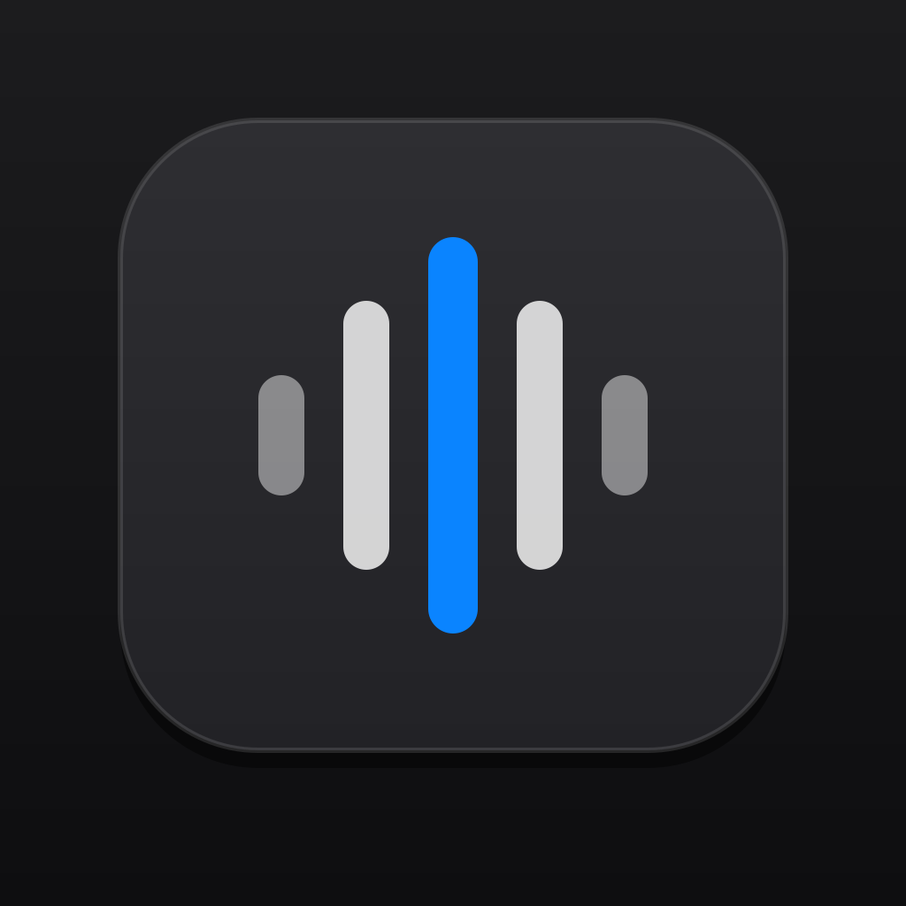

<p align="center">
  
</p>

<h1 align="center">KeyDeck</h1>

<p align="center">
  <strong>An open-source, bring-your-own-key iOS utility keyboard.</strong><br>
  Rambler voice dictation, Voice Edit, and an Alfred-style command palette — with zero backend.
</p>

<p align="center">
  <a href="https://afloresescarcega.github.io/keydeck/">Landing Page</a> ·
  <a href="https://afloresescarcega.github.io/keydeck/privacy.html">Privacy Policy</a> ·
  <a href="SECURITY.md">Security</a> ·
  <a href="DESIGN.md">Design System</a> ·
  <a href="LICENSE">MIT License</a>
</p>

---

## Why KeyDeck?

Apple's native QWERTY keyboard already nailed swipe typing and autocorrect, so KeyDeck doesn't try to replace it. Instead, KeyDeck is a **dedicated power keyboard** you switch to with the globe key whenever you want:

- **Rambler Voice Dictation** — Talk freely, pause, and self-correct; Gemini (single-pass multimodal audio) or OpenAI distills your stream of consciousness into clean, structured text and auto-inserts it straight into any app.
- **Voice Edit** — Select text (or use what's in the field) and speak an instruction (*"make this shorter"*, *"casual tone"*, *"translate to Spanish"*).
- **One-Tap Undo & Quick Tweaks** — Immediately refine inserted text (`Undo`, `Shorter`, `Bullets`, `Casual`, `Work`, `Raw`).
- **Explicit `Kill Mic` Control** — Persistent background audio session for instant in-place recording with a Dynamic Island Live Activity, plus one-tap **`Kill Mic`** from the keyboard, Dynamic Island, companion app, idle auto-kill, or auto-kill after every dictation.
- **Alfred Command Palette + Compact Mini-QWERTY** — Tap the search bar to run:
  - **Inline Math Calculator** (`18% of 240`, `(12 + 8) * 3`, `sqrt(144)`)
  - **Unit & Timezone Conversions** (`72f to c`, `10 km to mi`, `3pm est to cst`, `now tokyo`)
  - **Generators & Symbols** (`uuid`, `ts`, `iso`, `shrug`, `arrow`, `em`, `cmd`)
  - **Dynamic Snippets** (`{{date}}`, `{{time}}`, `{{clipboard}}`, `{{selection}}`, and interactive `{{input}}` arguments like `intro Bob`)
  - **Clipboard Manager & Pinned Clips**

## Security & App Store Readiness

- **Zero Backend / BYOK**: Direct HTTPS calls from your iPhone to Google Gemini (`x-goog-api-key` header) or OpenAI (`Bearer` token) using ephemeral zero-cache `URLSession`s.
- **Hardware-Bound Keychain**: Keys stored with `kSecAttrAccessibleAfterFirstUnlockThisDeviceOnly`.
- **Password Field Protection**: Automatically skips context capture when `textDocumentProxy.isSecureTextEntry == true`.
- **Privacy Manifests Included**: Ships with validated `PrivacyInfo.xcprivacy` manifests across all three targets (`KeyDeckApp`, `KeyDeckKeyboard`, `KeyDeckWidgets`), `ITSAppUsesNonExemptEncryption = false`, and `NSAllowsArbitraryLoads = false`.
- **Local Fallback Log**: Every recording is persisted encrypted-at-rest before network processing so long rambles are never lost if your connection drops.

See [SECURITY.md](SECURITY.md) and [PRIVACY.md](PRIVACY.md) for complete details.

## Quick Start (Build on Your iPhone)

Requires **Xcode 16+**, **iOS 17+**, [XcodeGen](https://github.com/yonaskolb/XcodeGen) (`brew install xcodegen`), and a paid Apple Developer account (required by Apple for App Groups, Shared Keychain, and Live Activities).

```bash
git clone https://github.com/afloresescarcega/keydeck.git
cd keydeck
cp Config/Local.xcconfig.example Config/Local.xcconfig
```

1. Edit `Config/Local.xcconfig` with your Apple Developer Team ID and reverse-DNS bundle prefix.
2. Generate the Xcode project and run unit tests:
   ```bash
   xcodegen generate
   swift test --package-path Packages/KeyDeckKit
   ```
3. Open `KeyDeck.xcodeproj`, select your iPhone, and run the **KeyDeck** scheme.
4. On your iPhone:
   - Open **KeyDeck → Settings** and add your Gemini and/or OpenAI API key.
   - Enable **iOS Settings → General → Keyboard → Keyboards → Add New Keyboard → KeyDeck** and toggle **Allow Full Access**.
   - *(Optional)* Set **iOS Settings → KeyDeck → Paste from Other Apps → Allow** for banner-free clipboard capture.

## Repository Layout

| Path | Description |
| --- | --- |
| `Packages/KeyDeckKit/` | Shared Swift 6 package: AI clients, `PromptBuilder`, `InlineUtilityEngine`, `SnippetEngine`, `AlfredSearchEngine`, `SharedKeychain`, `SharedStore`, Darwin IPC, and Swift Testing unit tests. |
| `Sources/KeyDeckApp/` | Native `.insetGrouped` SwiftUI companion app: persistent `AVAudioEngine` capture, Live Activity coordinator, History fallback log, Alfred Snippet & Clipboard manager, and Settings. |
| `Sources/KeyDeckKeyboard/` | Lightweight `UIInputViewController` extension: tactile `KeycapButtonStyle` dashboard, live reactive waveform, Undo/Tweak bar, expandable Alfred palette, and compact mini-QWERTY. |
| `Sources/KeyDeckWidgets/` | WidgetKit extension for Dynamic Island & Lock Screen Live Activities with direct `Kill Mic` action. |
| `Config/` | `Base.xcconfig` + `Local.xcconfig.example` (keep your real `Local.xcconfig` untracked). |
| `docs/` | GitHub Pages landing page and privacy policy. |

## License

MIT © 2026 [Alex Flores Escarcega](https://github.com/afloresescarcega). See [LICENSE](LICENSE).
